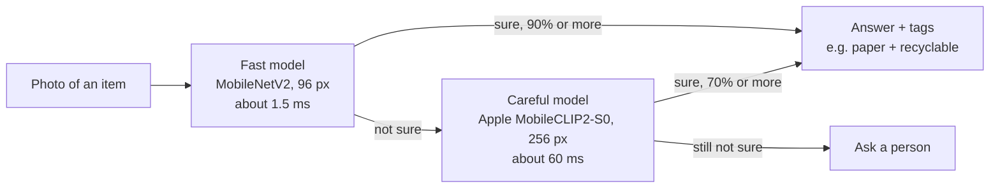
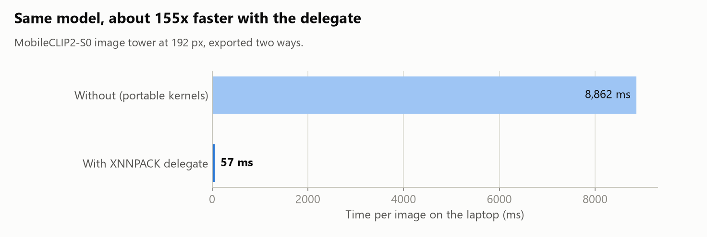
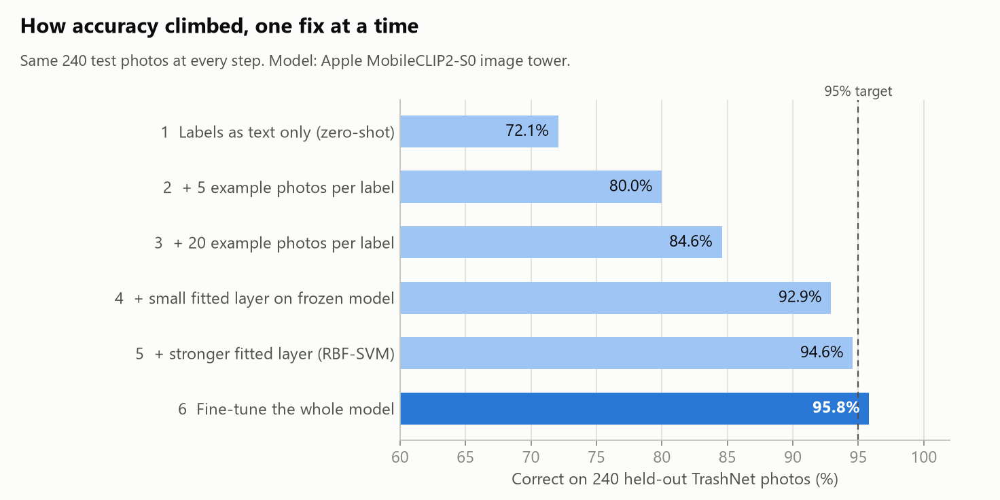
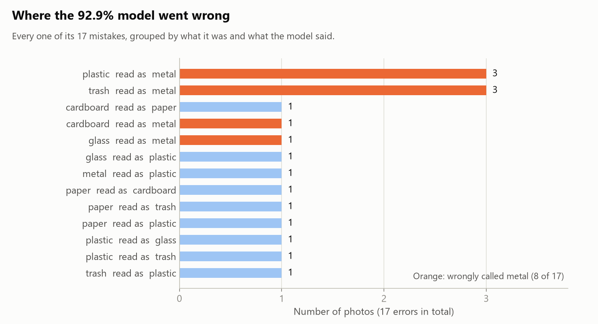
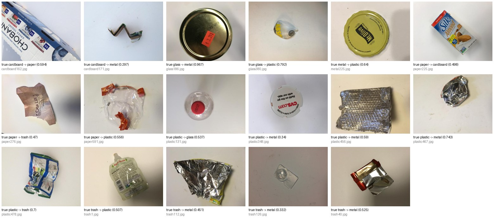
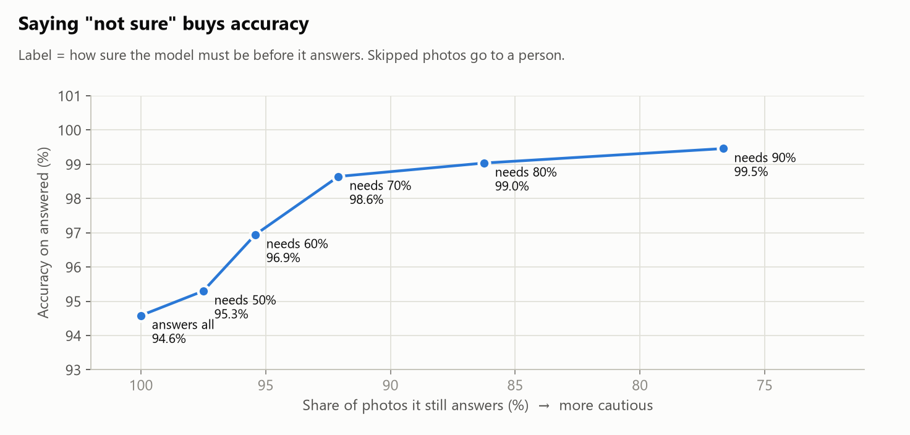
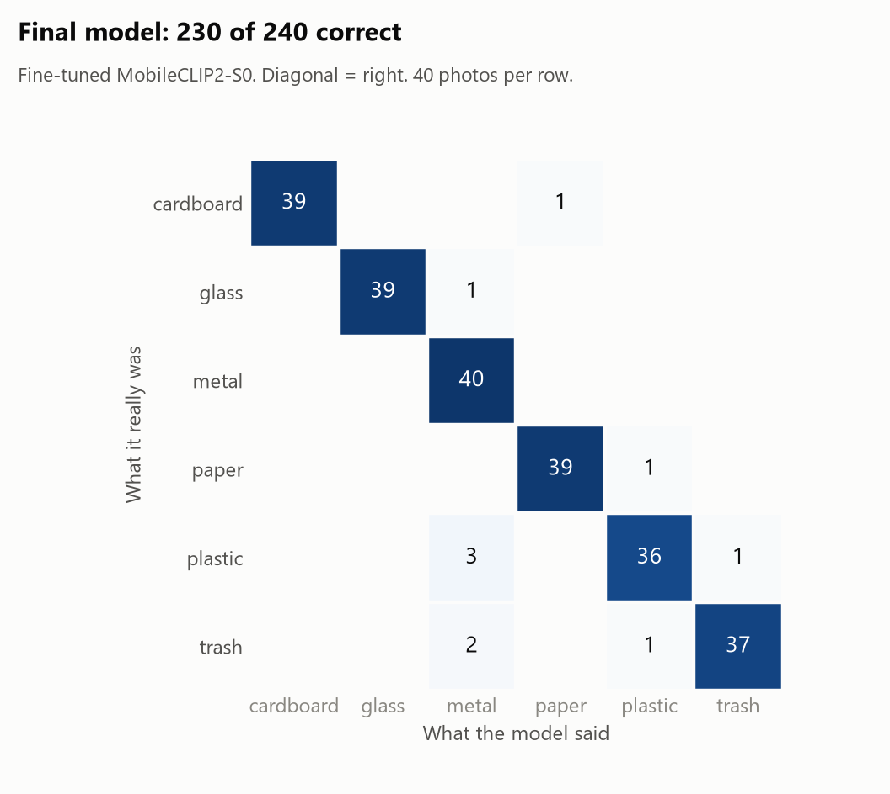
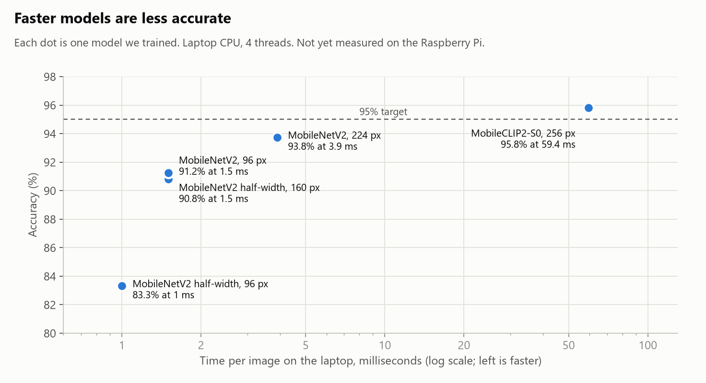
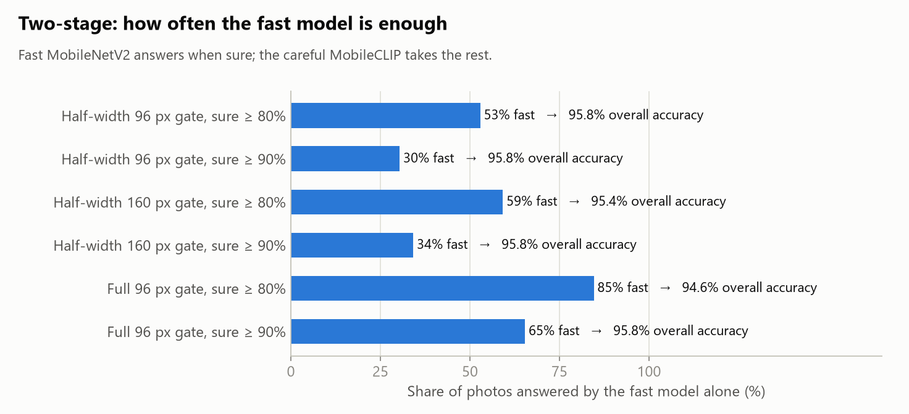
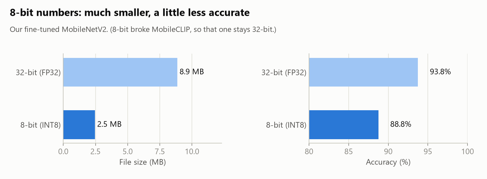

# BinSense: a pocket computer that tells you which bin

**Namma AI Hackathon 2026 · Problem Statement 3 · waste sorting on a Raspberry Pi with ExecuTorch**

Show BinSense a photo of something you are about to throw away. It tells you what it is, which bin it belongs in,
and how sure it is. It needs no internet.

> **Read this first.** Every number on this page was measured on a laptop, through the same code the Raspberry Pi
> will run. The Raspberry Pi run itself has not happened yet. Our test is also easier than real life (explained in
> [What we are not sure about](#what-we-are-not-sure-about)).

---

## Part 1: What we have

### In one picture



Two models work as a team. A small fast one answers the easy photos. A bigger careful one handles the hard ones.
If even the careful one is unsure, BinSense says so instead of guessing.

### The scoreboard

All on the same 240 test photos (6 kinds of waste, 40 photos each).

| What | Result |
|---|---|
| Best accuracy (careful model alone) | **95.8%** (230 of 240) |
| Fast model alone, 224 px | 93.8% in 3.9 ms |
| Smallest model alone, 96 px half-width | 83.3% in about 1 ms |
| Both together (two-stage) | **95.8%**, with 65% of photos answered by the fast model |
| Recyclable vs not recyclable | 97.5% |
| Accuracy when allowed to say "not sure" | 98.6% on the 92% of photos it answers |
| Model files | 45.5 MB (careful), 8.9 MB (fast), 2.8 MB (smallest) |
| Speed-up from the XNNPACK delegate | about 155x |

### What is in the box

- **13 ready model files** (`.pte`, the format ExecuTorch runs).
- **An engine** that gives typed answers: one label, several labels at once, yes/no, or a 1-5 score.
- **A sorting service** that watches a folder, sorts photos, keeps a log of every decision, and sets aside anything it is unsure about.
- **Pi scripts** for setup, tuning, hardware inspection and a full benchmark.
- **A labels file.** New category names from the organisers go in a text file; the model does not need retraining.

---

## Part 2: The story

### Chapter 1. The problem

People throw things in the wrong bin. One food-soiled bag in the paper bin can spoil the whole load.
The organisers asked: can a small, cheap, offline computer look at an item and name its category?

The hard part: **the organisers choose the category names, and we did not know them in advance.**

### Chapter 2. Picking the first model

A normal image classifier is built for one fixed list of labels. We needed one that understands labels written as words.
That family of models is called CLIP: it turns a picture into a list of numbers, turns words into a list of numbers,
and the two lists land close together when the picture matches the words.

We chose **Apple's MobileCLIP2-S0**, the smallest of its family:

| Why | Detail |
|---|---|
| Understands words | Any label name works with no retraining |
| Small enough for a Pi | The picture half has 11.4 million numbers inside it (45.5 MB) |
| Splits in two | Only the picture half goes on the Pi; the word half runs once on the laptop |
| Survives ExecuTorch export | The exported file matched the original exactly |

### Chapter 3. Getting it into ExecuTorch

ExecuTorch needs the model converted into one file. During conversion, the heavy maths can be handed to a library
tuned for Arm chips (called the XNNPACK delegate). We exported the same model with and without it:



Of the model's 376 steps, 325 were handed to XNNPACK. The other 51 are small bookkeeping steps it does not support.

### Chapter 4. Climbing from 72% to 96%

We tested on TrashNet, a public set of 2,527 waste photos. We set 240 aside as the test and never trained on them.



| Step | What we saw | What we did next |
|---|---|---|
| 1 | **72.1%.** Over a quarter wrong. Words like "trash" are too vague for the model to match. | Show it example photos, not just words. |
| 2-3 | **80.0%, then 84.6%.** Better, but look-alike materials still got mixed up. | Fit one small layer on top of the frozen model. |
| 4 | **92.9%.** 17 mistakes left. | Look at every mistake (next chapter). |
| 5 | **94.6%** with a stronger layer. Still short of 95%. | Retrain the whole model on a cloud GPU. |
| 6 | **95.8%.** Target met. | Make it fast (chapter 6). |

### Chapter 5. Looking at what went wrong

At 92.9% we stopped and looked at all 17 mistakes one by one.



**Nearly half the mistakes (8 of 17) were things wrongly called metal.** Looking at the photos shows why:



- **Shiny plastic looks like metal.** Crisp packets and foil-look mailers are plastic or trash, but they shine.
- **Some labels are debatable.** A photo of a jar's metal lid is labelled "glass". A drink carton is labelled "paper".
- **Small things get lost.** When the item is tiny in the frame, the model mostly sees table.

What we tried, and what it did:

| Fix | Result |
|---|---|
| Zoom in on the item before classifying | No reliable gain |
| A stronger layer on top | 94.6% |
| Let it say "not sure" | See below |
| Retrain the whole model so it learns shiny plastic is not metal | **95.8%** |

The model is much less confident when it is wrong (0.56 on average) than when it is right (0.85).
So "not sure" is a useful signal:



After retraining, here is every answer of the final model. The diagonal is correct:



The remaining 10 mistakes are still mostly plastic or trash called metal (5 of 10).

### Chapter 6. Making it fast

The careful model takes about 60 ms per photo on the laptop. We wanted far less, so we trained a much smaller model,
MobileNetV2 (2.2 million numbers inside it), and then even smaller versions of it.
The small ones learned by copying the careful model's answers, a method called distillation.



**The lesson: about 1 ms is possible, but only at about 83%. 95% and 1 ms did not happen in one model.**

All six small models, timed on a cloud CPU:

| Model | Photo size | Accuracy | Time | File |
|---|---|---|---|---|
| MobileNetV2 | 160 px | 93.8% | 4.2 ms | 8.9 MB |
| MobileNetV2 | 128 px | 91.3% | 3.0 ms | 8.9 MB |
| MobileNetV2 | 96 px | 90.0% | 1.8 ms | 8.9 MB |
| MobileNetV2 half-width | 160 px | 90.8% | 1.9 ms | 2.8 MB |
| MobileNetV2 half-width | 128 px | 88.3% | 1.2 ms | 2.8 MB |
| MobileNetV2 half-width | 96 px | 84.6% | 0.77 ms | 2.8 MB |

(Accuracy here is from the cloud run; the chart above re-measured three of them through the Pi engine on the laptop.)

### Chapter 7. Using both models together

Since no single model was both fast and accurate, we let them share the work.
The fast one answers when it is sure. The careful one takes the rest.



Best setting: the 96 px MobileNetV2 answers 65% of photos on its own, and overall accuracy stays at 95.8%.

### Chapter 8. Shrinking the numbers (what worked and what broke)

Models store their numbers in 32 bits each. Storing them in 8 bits makes the file about four times smaller.



- **MobileNetV2:** works. Much smaller, about 5 points less accurate.
- **Apple's MobileCLIP:** broke. Its answers no longer resembled the original, so it stays 32-bit.

### Things that did not work

| Tried | Outcome |
|---|---|
| 8-bit version of MobileCLIP (full and partial) | Broken output |
| Bigger models (MobileCLIP2-S2, DINOv2) | No accuracy gain, 2 to 4 times slower |
| Six small ready-made models with a layer on top | Best was 89.2% |
| Training on the laptop while other jobs ran | One step took 59 seconds; moved to a cloud GPU |
| Four of the ten small "student" models | Failed because of a bug in our own training script |

---

## What we are not sure about

- **No Raspberry Pi numbers yet.** Speeds above are from a laptop and a cloud CPU. The Pi 4 will be slower.
- **Our test is easier than real life.** TrashNet has near-identical photos taken one after another, and some ended up on
  both sides of our split. When one experiment removed those neighbours from training, a model dropped about 6 points.
- **240 photos is a small test.** One photo is 0.4 points.
- **The organisers' photos and labels have not arrived.** The trained models know six TrashNet labels. If the organisers
  use different labels, the untouched pretrained model handles them from a text file.
- **A few settings were picked by looking at the test results** (the two-stage thresholds).

## Run it on a Raspberry Pi 4

Copy `pi_bundle/` to the Pi (64-bit Raspberry Pi OS), then:

```bash
bash setup_pi.sh                 # one-time, needs internet
source ~/binsense-venv/bin/activate
bash tune_pi.sh                  # keep the CPU at full speed, stop background services
python run_eval.py --pte models/own_mobileclip2_s0_256_fp32.pte --pack packs/own_mobileclip2_s0_256.npz --images images
bash bench_pi.sh                 # every model x 1-4 threads + temperature log -> results/SUMMARY.md
```

`run_eval.py` prints what the brief asks for: a prediction per image, a results table against the given labels,
total correct, accuracy, the model used, time per image, file size and peak memory.
More commands (two-stage, baselines, hardware tools) are in `pi_bundle/README.txt`.

## Where things are

| Path | What |
|---|---|
| `edge/` | Code that runs on the Pi |
| `src/` | Laptop scripts: export to `.pte`, build label files, fit layers |
| `colab/` | Cloud GPU notebooks and the trained models |
| `pi_bundle/` | Ready-to-copy folder for the Pi |
| `bets/` | Side experiments, each with its own log |
| `results/` | Every result table (Markdown, CSV, JSON) |
| `docs/img/` | The charts on this page, and [`data_points.json`](docs/img/data_points.json) with every number behind them |
| `docs/` | [Two-minute pitch](docs/PITCH.md), [plain-language explainer](docs/LEARN.md), and `make_charts.py` to redraw the charts |

## Credits and licences

- **MobileCLIP2-S0** (via open_clip): Apple's model terms apply.
- **MobileNetV2**: public ImageNet weights (BSD-3 for torchvision; timm weights for the students).
- **TrashNet**: MIT. Other datasets are listed in `bets/data/DATASETS.md`.
- **ExecuTorch 1.3.1, PyTorch 2.12.1.** Export flow adapted from Arm's course code.
- BinSense is an independent project. The typed-answer idea was inspired by TypeSafe's Jev decision model;
  BinSense does not use Jev, its weights or its API, and is not affiliated with TypeSafe.
